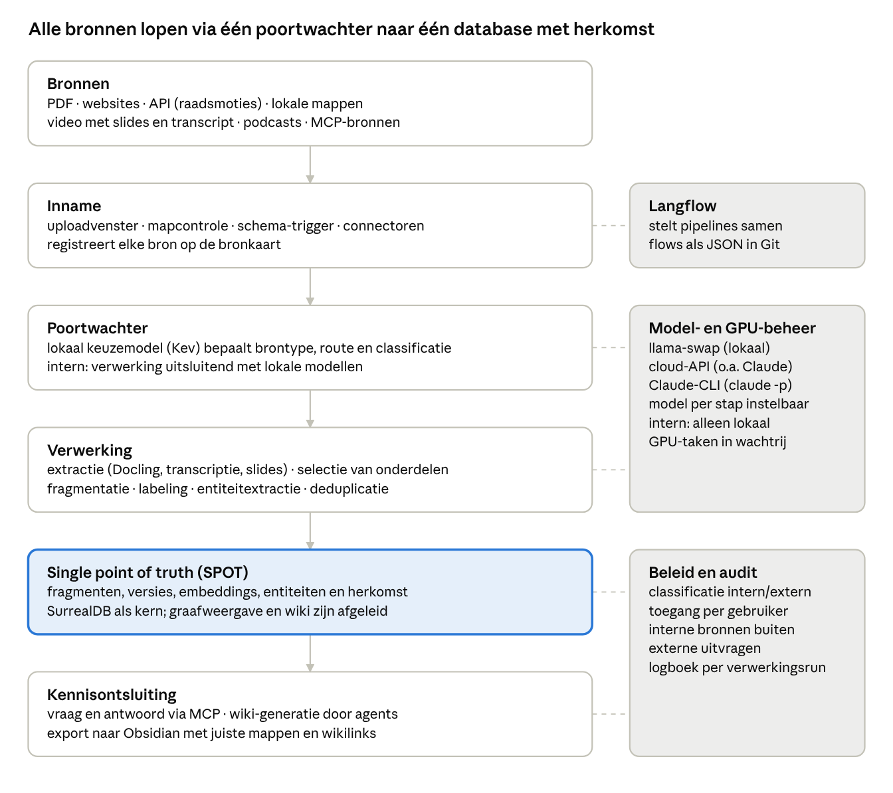
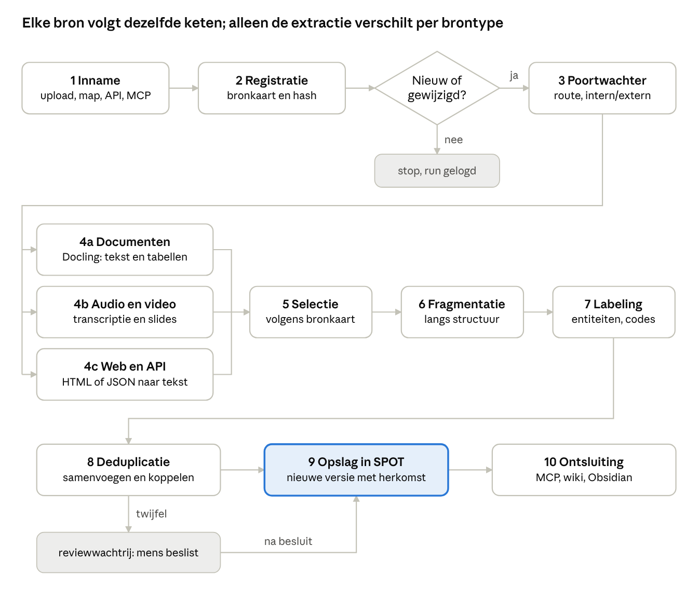
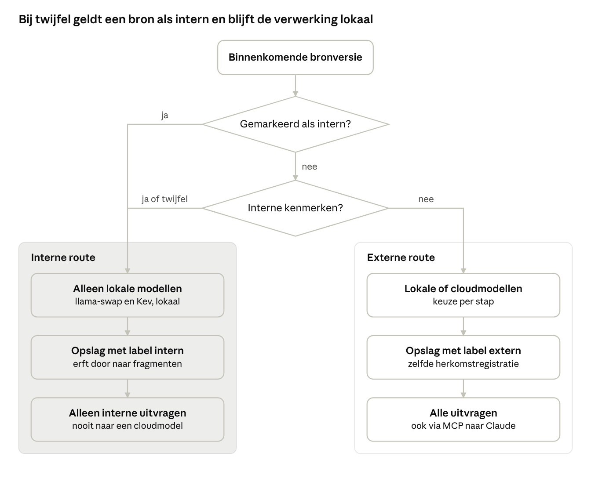
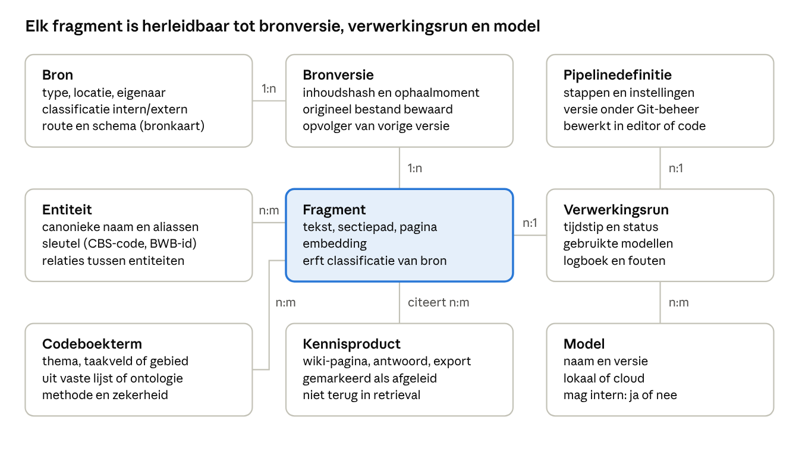
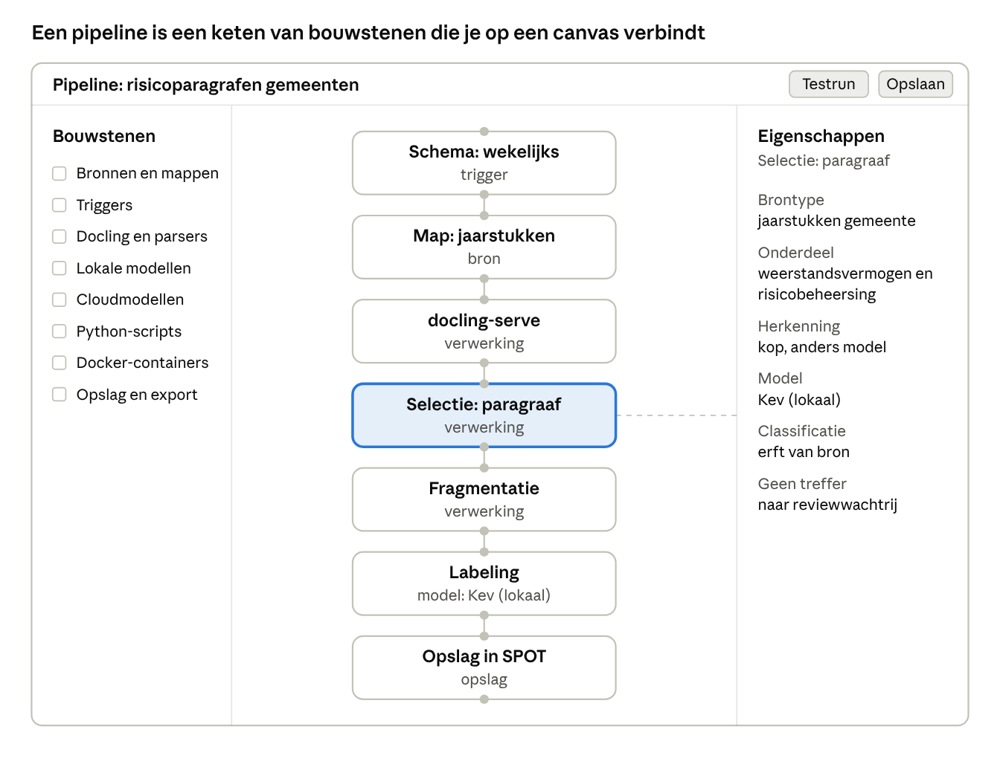
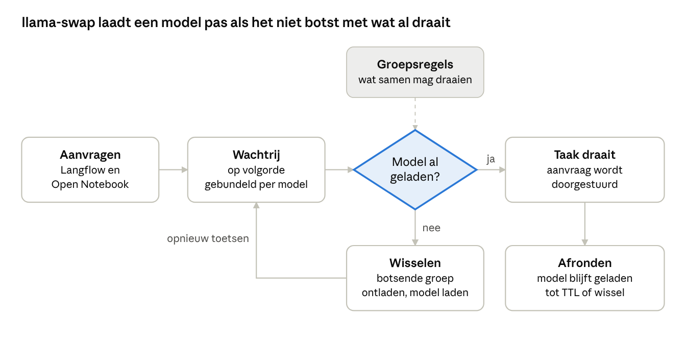
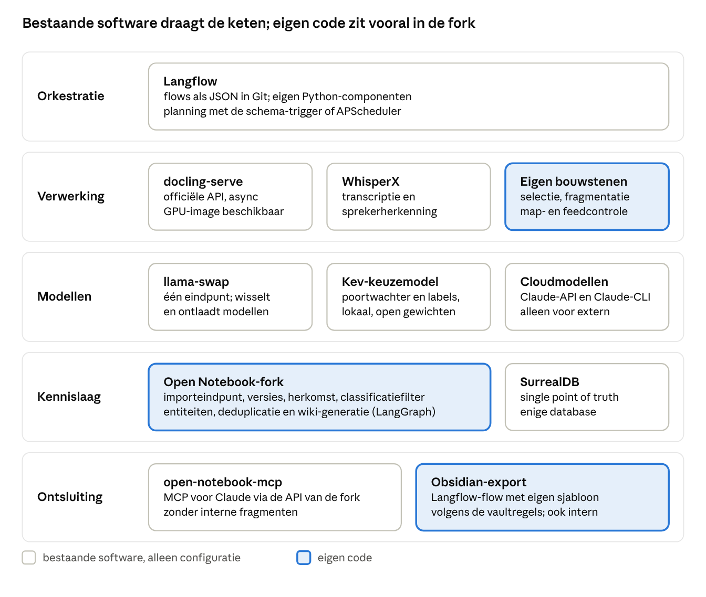

# Functioneel ontwerp signaalsysteem

Stand: 29 oktober 2026 · Geert de Joode

> Dit bestand is de export van het functioneel ontwerp (FO). Het FO is leidend voor het werk in deze map. Wijzigingen in het ontwerp lopen via een ontwerpbesluit in `adr/` en worden daarna in dit bestand verwerkt.

## 1. Doel en scope

Het signaalsysteem haalt bronnen automatisch binnen, verwerkt ze tot gelabelde tekstfragmenten en slaat die op met versie en herkomst. De centrale database is de single point of truth (SPOT) voor vraag-en-antwoordtoepassingen, wiki-generatie en export naar Obsidian. Open Notebook vormt het fundament.

| Gebruiker | Gebruik |
| --- | --- |
| Beheerder (Geert) | stelt pipelines samen, beheert de bronkaart, beslist over twijfelgevallen en classificatie |
| Agents via Model Context Protocol (MCP) | stellen vragen, genereren wiki-pagina's, schrijven naar de Obsidian-vault |
| Collega's | eventueel in een latere fase (zie paragraaf 14) |

**Binnen scope**

- Inname uit zeven brontypen: PDF, websites, Application Programming Interfaces (API's), lokale mappen, video, podcasts en MCP-bronnen.
- Automatische verwerking: extractie, fragmentatie, labeling, entiteitextractie en deduplicatie.
- Opslag met versiebeheer, herkomstregistratie en classificatie intern of extern.
- Ontsluiting via MCP, wiki-generatie en export naar Obsidian.
- Een grafische beheeromgeving voor het samenstellen van pipelines.

**Buiten scope**

- Inhoudelijke duiding en weging van signalen. Het systeem levert gelabelde fragmenten; de duiding volgens het toetsingskader signaalmanagement blijft mensenwerk.
- Bewerking van brondocumenten. Bronnen worden alleen gelezen.

## 2. Ontwerpprincipes

Acht principes sturen alle ontwerpkeuzes in dit document.

1. **Modulair.** Elke stap is een losse bouwsteen met vaste invoer en uitvoer. Een bouwsteen is te vervangen zonder de rest van de keten aan te passen.
2. **Declaratief.** Een pipeline is een definitiebestand onder versiebeheer. De grafische editor en Claude Code-agents bewerken hetzelfde bestand.
3. **Modelagnostisch.** Elke modelaanroep loopt via één modelpoort. Per stap is het model een instelling: lokaal via llama-swap, via een cloud-API zoals Claude of via de Claude Command Line Interface (CLI) in niet-interactieve modus (claude -p). Elke taak die de GPU gebruikt, loopt via llama-swap (paragraaf 12).
4. **Intern blijft lokaal.** Classificatie gaat vóór elke modelaanroep. Een intern fragment wordt alleen door lokale modellen verwerkt en komt nooit in een externe uitvraag.
5. **Herkomst altijd.** Elk fragment verwijst naar bronversie, positie, verwerkingsrun en model. Door modellen gegenereerde tekst is gemarkeerd als afgeleid en keert niet terug als bronmateriaal; anders versterken modelteksten zichzelf in het corpus.
6. **Herhaalbaar.** Dezelfde bronversie met dezelfde pipelineversie geeft hetzelfde resultaat. Herverwerking levert een nieuwe versie op en overschrijft niets.
7. **Hergebruik boven zelf bouwen.** Wat Open Notebook en andere bestaande open-sourcesoftware al bieden, wordt hergebruikt; alleen wat ontbreekt, wordt toegevoegd.
8. **Eenvoud eerst.** Eerst een werkende keten voor twee brontypen, daarna uitbreiden.

## 3. Systeemoverzicht

Het systeem bestaat uit zes lagen in vaste volgorde, met drie diensten die over de lagen heen werken.

*architectuur · 6 lagen, 3 diensten*

De doorgetrokken pijlen volgen de gegevensstroom; de stippellijnen tonen welke dienst een laag gebruikt. Alle verwerkte gegevens staan in de SPOT; de lagen erboven bewaren niets.

## 4. Verwerkingspipeline

Elke bron doorloopt dezelfde tien stappen; alleen de extractie verschilt per brontype. Een ongewijzigde bron stopt na de versiecheck.

*verwerkingspipeline · 10 stappen, 1 vertakking*

Stap 4 splitst per brontype en komt bij stap 5 weer samen. Twijfelachtige samenvoegingen van entiteiten wachten in de reviewwachtrij op een besluit.

| Stap | Functie | Uitvoer |
| --- | --- | --- |
| 1. Inname | bron ontvangen of ophalen | ruwe bron |
| 2. Registratie | bronkaartregel vinden, inhoudshash berekenen | bronversie, of stop als de hash bekend is |
| 3. Poortwachter | brontype, route en classificatie bepalen | gerouteerde bronversie |
| 4. Extractie | tekst en structuur uit document, audio, video of web | gestructureerde tekst |
| 5. Selectie | alleen de onderdelen uit de bronkaart overhouden | geselecteerde secties |
| 6. Fragmentatie | opknippen langs de structuur | fragmenten met sectiepad |
| 7. Labeling | entiteiten en codeboektermen toekennen | gelabelde fragmenten |
| 8. Deduplicatie | entiteiten samenvoegen en koppelen | gekoppelde entiteiten, twijfelgevallen in review |
| 9. Opslag | wegschrijven als nieuwe versie met herkomst | records in de SPOT |
| 10. Ontsluiting | kennisproducten afleiden | antwoorden, wiki-pagina's, exports |

## 5. Bronnen en bronkaart

De bronkaart bepaalt per bron wat het systeem ophaalt, hoe vaak, langs welke route en met welke classificatie. Een bron zonder bronkaartregel gaat naar de wachtrij van de beheerder; een handmatige upload krijgt bij het uploaden een regel, met een voorstel van de poortwachter.

**Brontypen**

| Brontype | Inname | Moment | Verwerking |
| --- | --- | --- | --- |
| PDF (handmatig) | uploadvenster of inboxmap | direct | Docling |
| Lokale map | mapbewaker op een opgegeven pad | bij nieuw of gewijzigd bestand | volgens bestandstype |
| Website | pagina of sitemap ophalen | volgens schema | HTML naar tekst, wijzigingsdetectie op inhoud |
| API, bijvoorbeeld raadsmoties | connector per API | volgens schema | velden naar tekst en metadata, bijlagen als document |
| Video | bestand, link of YouTube-kanaal | direct of volgens schema | transcript plus slides uit beeld |
| Podcast | RSS-feed (ook via Spotify-link) of bestand | volgens schema | transcript met sprekerherkenning |
| MCP-bron | MCP-client naar een externe server | volgens schema of op verzoek | resultaat als document |

**Planning**

- De schema-trigger van Langflow start flows volgens het schema in de bronkaart. Hij zit in Langflow 1.13.0 en wordt via de API aangezet; APScheduler is de beproefde terugval (P2, 30-10; ADR 0017).
- Map- en feedcontrole zijn Python-componenten in Langflow, op basis van watchdog en feedparser.
- Wijzigingsdetectie op inhoudshash: alleen nieuwe of gewijzigde inhoud gaat de keten in.
- Elke taak levert een verwerkingsrun op met status en logboek, ook als er niets nieuws was.
- Een mislukte taak wordt opnieuw geprobeerd en daarna gemeld aan de beheerder.

**YouTube-kanalen en podcasts**

Nieuwe video's en afleveringen zijn eenvoudig te detecteren via feeds. De beperking zit in het ophalen van de inhoud; daarom legt de bronkaart per kanaal vast wat het systeem mag ophalen (veld Inhoud ophalen).

| Bron | Detectie | Inhoud | Aandachtspunt |
| --- | --- | --- | --- |
| YouTube-kanaal | openbare kanaalfeed `youtube.com/feeds/videos.xml?channel_id=UC…`, zonder API-sleutel; bevat ongeveer de laatste 15 uploads | titel, beschrijving en datum altijd; audio, ondertitels of beeld alleen met toestemming van de rechthebbende | de gebruiksvoorwaarden van YouTube staan downloaden alleen toe waar YouTube of de rechthebbende dat toestaat; ondertitels via de officiële API vragen autorisatie van de eigenaar van de video |
| YouTube, alternatief | YouTube Data API: uploads-playlist van het kanaal (kanaal-id met UU in plaats van UC), 1 quota-eenheid per aanroep | als hierboven | API-sleutel nodig; standaardquotum 10.000 eenheden per dag |
| Podcast met Spotify-link | Spotify-link omzetten naar de openbare RSS-feed van dezelfde show, bijvoorbeeld via de [Podcast Index](https://podcastindex.org); daarna die feed pollen | audiobestand uit de feed, lokaal getranscribeerd met WhisperX | Spotify stelt geen audiobestanden beschikbaar; een show die alleen op Spotify staat, is niet te verwerken |

- De feedcontrole in Langflow pollt de feed. Elk nieuw item (video-id of aflevering-GUID) wordt een eigen bron met een bronversie; detectie loopt op id, niet op inhoudshash. Dat werkt voor een YouTube-kanaalfeed en een podcastfeed (P6, 29-10). Geen van beide stuurde `ETag` of `Last-Modified`, dus elke controle haalt de hele feed op (bij NOS De Dag 2 357 items).
- Een Spotify-link is zonder API-sleutel om te zetten: shownaam uit de Spotify-pagina, kandidaatfeed via de iTunes Search API, en een controle dat de titel van de nieuwste aflevering (oEmbed van Spotify) in die feed staat (P6, 29-10).
- Het schema moet zo kort zijn dat er tussen twee controles minder dan 15 video's verschijnen. Voor het archief van een kanaal is de Data API nodig.
- Polling vanaf de eigen machine is betrouwbaarder dan vanaf een cloudserver; de YouTube-feed geeft aan datacenter-IP-adressen soms foutmeldingen.
- Voor debatten van de Tweede Kamer of gemeenteraden is de officiële bron (verslag of raadsinformatiesysteem) te verkiezen boven de YouTube-versie: die levert tekst zonder transcriptie.
- Openbare kanalen en podcasts krijgen classificatie extern.

Bronnen: [YouTube-feedformaat en beperkingen](https://finder.wprssaggregator.com/rss-feeds/platform/youtube) · [quotum YouTube Data API](https://outlierkit.com/resources/youtube-api-quota/) · [Spotify-links en openbare RSS-feeds](https://apify.com/spokentext/spotify-podcast-transcript.md)

**Bronkaartregel**

| Veld | Inhoud | Voorbeeld: jaarstukken gemeenten |
| --- | --- | --- |
| Naam | herkenbare naam | Jaarstukken gemeenten |
| Brontype en locatie | type plus pad, URL of API-eindpunt | lokale map met jaarstukken |
| Schema | moment van ophalen of controleren | wekelijks |
| Classificatie | intern of extern; onbekend geldt als intern; standaard per innameroute (ADR 0019) | extern |
| Documentsoort | verwacht soort document | jaarrekening, begroting |
| Route | pipeline die het document volgt | risicoparagrafen gemeenten |
| Selectie | te extraheren onderdelen; leeg betekent alles | paragraaf weerstandsvermogen en risicobeheersing |
| Labelschema | codeboek of ontologie voor labeling | taakvelden Informatie voor derden (Iv3), brede-welvaartthema's |
| Eigenaar | verantwoordelijke voor de bron | beheerder |
| Inhoud ophalen | wat van een item wordt opgehaald: alleen metadata, transcript of volledige media | volledig document |

## 6. Poortwachter en classificatie

De poortwachter routeert elke bronversie en bepaalt of de verwerking lokaal moet blijven. Bij twijfel geldt een bron als intern.

*classificatie · 2 beslissingen, 2 routes*

Een markering intern op de bronkaart gaat altijd voor. Ook bronnen met markering extern worden op interne kenmerken gecontroleerd, zodat een vertrouwelijk document in een externe map niet ongemerkt naar een cloudmodel gaat.

**Taken**

- Brontype en documentsoort herkennen, bijvoorbeeld jaarrekening, raadsmotie of onderzoeksrapport.
- De route kiezen: de pipeline uit de bronkaart, of de reviewwachtrij als geen regel past.
- Interne kenmerken herkennen, zoals een rubriceringsmarkering, een conceptstatus of een interne afzender.

**Werking**

- Regels eerst: bronkaart, map en bestandskenmerken beslissen de meeste gevallen.
- Een lokaal keuzemodel beoordeelt alleen wat de regels openlaten. Het geeft per mogelijke route een gekalibreerde kans; onder een drempel gaat de bron naar review.
- De poortwachter draait altijd lokaal, omdat hij inhoud ziet voordat de classificatie bekend is.
- De poortwachter kan een bron niet van intern naar extern zetten; dat kan alleen de beheerder.

**Keuzemodel**

Een keuzemodel (decision model) geeft geen tekst terug, maar per vraag een keuze, een ja of nee of een score, met gekalibreerde kansen. Dat past bij de poortwachter en bij labeling met een vaste keuzelijst.

| Model | Beschikbaarheid | Inzet |
| --- | --- | --- |
| Jev (TypeSafe AI) | alleen als gehoste API, geen publieke gewichten | niet gebruikt |
| Kev (Jared Palmer) | open gewichten (Apache-2.0) in 0,8B, 4B, 9B en 27B op Qwen3.5, met lokale server | poortwachter en alle labels |

De poortwachter ziet inhoud voordat de classificatie vaststaat en draait daarom altijd lokaal, dus met Kev. Volgens de publicaties scoort Kev-9B iets lager dan Jev; de referentieset toetst of dat voor dit gebruik uitmaakt. De modelgrootte volgt uit het GPU-budget. Kev-9B vraagt volgens de README ongeveer 17 GB en past niet. Gekozen is Kev-4B (ADR 0009): in bf16 gebruikt hij ongeveer 14,6 GB videogeheugen, en samen met het embeddingmodel 15,2 GB, net binnen het budget (P3, 30-10). Kev-0,8B is de terugval.

Bronnen: [Jev uitgelegd](https://simonw.substack.com/p/jev-introduces-a-new-shape-of-llm) · [Jev lokaal draaien](https://horadecodar.com.br/?p=47570) · [Kev](https://runtimewire.com/article/jared-palmer-kev-qwen35-decision-models)

## 7. Extractie, fragmentatie en labeling

Elke tekst wordt langs de documentstructuur opgeknipt en tegen vaste referentielijsten gelabeld. Modellen doen voorstellen; deterministische controles buiten het model beslissen of een label blijft staan.

| Stap | Werkwijze | Component |
| --- | --- | --- |
| Documentextractie | PDF, Office en HTML naar gestructureerde tekst met koppen, tabellen en leesvolgorde | docling-serve |
| Audio en podcasts | transcriptie met tijdcodes en sprekerherkenning | WhisperX |
| Video | transcript als bij audio; slides als beeld bij elke scènewissel, tekst via Optical Character Recognition (OCR); slide en transcript gekoppeld via tijdcode | beeldextractie, Docling, WhisperX |
| Web en API | HTML via Docling; API-velden naar vaste velden, bijlagen als document | connector per bron |
| Selectieve extractie | eerst zoeken op kop in de Docling-structuur; geen treffer, dan sectieclassificatie door een lokaal model; nog geen treffer, dan reviewwachtrij | selectiebouwsteen |
| Fragmentatie | per sectie en alinea, tabellen als geheel; elk fragment houdt sectiepad en paginanummer | fragmentatiebouwsteen |
| Entiteiten | organisaties, gebieden, programma's en wetten, gekoppeld aan referentielijsten zoals gemeentecodes van het Centraal Bureau voor de Statistiek (CBS) en id's uit het Basiswettenbestand (BWB) | LangGraph-module in de fork, met validatie tegen referentielijsten |
| Labels | termen uit het codeboek: Iv3-taakvelden, brede-welvaartthema's, foundational thema's voor signaalweging | lokaal keuzemodel (Kev) met vaste keuzelijst en kans per label |
| Deduplicatie | drie lagen: tekstgelijkenis, embedding, modeldisambiguatie; matchen en samenvoegen als aparte stappen | LangGraph-module in de fork, met review bij twijfel |

**Voorbeeld selectieve extractie.** Bij jaarstukken van gemeenten zoekt de selectiestap de verplichte paragraaf weerstandsvermogen en risicobeheersing uit het Besluit begroting en verantwoording provincies en gemeenten (BBV). Alleen die paragraaf gaat door naar fragmentatie en labeling.

**Kwaliteitsborging**

- Canonieke namen volgen de vaultregel: bij fusie of opvolging geldt de meest recente naam.
- Een regio uit het Nationaal Programma Vitale Regio's (NPVR) verwijst ook naar de onderliggende gemeenten.
- Kwaliteit wordt gemeten tegen een gelabelde referentieset van 200 tot 300 fragmenten. Zonder die set is een verbetering in precisie of recall niet aantoonbaar.

## 8. Datamodel van de single point of truth

Het fragment is de kern van het datamodel: elk fragment is herleidbaar tot bronversie, verwerkingsrun en model. Negen objecttypen dekken bron, verwerking, kennis en afgeleide producten.

*datamodel · 9 objecttypen*

Lijnen tonen relaties met hun kardinaliteit; n:m betekent dat beide kanten meerdere verwijzingen kunnen hebben.

**Versiebeheer**

- Een gewijzigde bron levert een nieuwe bronversie op; de vorige blijft bewaard.
- Fragmenten horen bij één bronversie. Zoekresultaten tonen standaard de nieuwste versie; oudere blijven raadpleegbaar.
- Herverwerking met een nieuwe pipelineversie maakt een nieuwe run en nieuwe fragmenten; de oude blijven traceerbaar.
- Handmatige correcties, zoals het samenvoegen van entiteiten, worden vastgelegd met auteur en tijdstip. Optimistische vergrendeling voorkomt dat een run een handmatige wijziging overschrijft.

**Herkomstregistratie**

- Elk record verwijst naar de run die het maakte; elke run naar pipelineversie en modellen.
- De registratie volgt de begrippen van PROV-O (entiteit, activiteit, actor), zodat een export naar het Resource Description Framework (RDF) mogelijk blijft.

## 9. Modelbeleid en beveiliging

De modelpoort dwingt het beleid af: een fragment met label intern bereikt nooit een cloudmodel. Het beleid wordt op drie plekken afgedwongen, nooit in een prompt: het Docker-netwerk (verwerkingscontainers hebben geen internet), de modelkeuze in de Langflow-componenten en het filter in de API van de fork.

**Modelregister**

Per model legt het register vast: naam en versie, aanroepwijze (llama-swap, API of CLI), locatie (lokaal of cloud), toegestaan voor intern (ja of nee) en geschikte taken. Lokale modellen draaien via llama-swap op de eigen grafische kaart (GPU); cloudmodellen via hun API. De poortwachter en de labeling gebruiken een lokaal keuzemodel (paragraaf 6).

**Claude-CLI als model**

De modelpoort kan een stap ook uitvoeren met `claude -p`: de prompt gaat via stdin naar de CLI en het antwoord komt terug als JSON (`--output-format json`). Voor het beleid is dit een cloudmodel als elk ander.

- Alleen voor fragmenten met label extern; dezelfde beleidsregels als voor de cloud-API.
- De CLI draait in een lege, tijdelijke werkmap, zonder tools of met een vaste lijst toegestane tools. Zo kan hij geen lokale bestanden lezen, ook geen interne.
- Elke aanroep start met verse context; er wordt geen eerdere sessie hervat.
- Het model ligt per stap vast via `--model`; de run registreert ook CLI-versie en exitcode.
- De doorvoer is begrensd door de gebruikslimieten van het account. De CLI past daarom vooral bij taken met beperkt volume, zoals wiki-generatie, citaatcontrole en review van twijfelgevallen.

**Beleidsregels**

| Regel | Uitwerking |
| --- | --- |
| Intern alleen lokaal | De poort weigert een cloudmodel voor een intern fragment. Bij een fout is er geen terugval naar de cloud. |
| Onbekend is intern | Een bron zonder classificatie wordt als intern behandeld tot de beheerder anders beslist. Bronnen via API, MCP, feed of website zijn standaard extern; een bulkupload krijgt een classificatie per batch; een watchfolder wacht op de beheerder (ADR 0019). |
| Overerving | Classificatie gaat over van bron op versie, fragment en embedding. Een kennisproduct is intern zodra één bronfragment intern is. |
| Externe uitvraag | Elke vraag die via een cloudmodel loopt, ook via MCP naar Claude, is een externe uitvraag. Interne fragmenten worden in de query uitgefilterd, voordat een model iets ziet. |
| Lokale embeddings | Embeddings van interne fragmenten worden lokaal berekend. |
| Audit | Elke modelaanroep wordt gelogd met run, model en classificatie. Interne inhoud komt niet in logs buiten de lokale omgeving. |

**Toegang**

- De toegangsbeveiliging van Open Notebook blijft de basis. Elke gebruiker en elke agent krijgt een eigen sleutel met rechten: lezen extern, lezen intern of beheren.
- API-sleutels van cloudaanbieders worden versleuteld opgeslagen.
- Toegang op afstand loopt alleen via het eigen privénetwerk (Tailscale).

## 10. Kennisontsluiting

Alle kennisproducten worden uit de SPOT afgeleid en verwijzen per bewering naar fragmenten. Drie routes ontsluiten de database, elk met een eigen regel voor interne bronnen. Er is geen eigen chatfunctie; vragen lopen via Claude.

| Route | Werking | Interne bronnen |
| --- | --- | --- |
| MCP-koppeling met Claude | MCP-server met zoek- en leestools; Claude stelt vragen en citeert fragmenten | uitgesloten |
| Wiki-generatie | agent stelt per onderwerp pagina's samen, bijvoorbeeld over het NPVR of de Regio Deals | alleen bij lokale generatie; de pagina krijgt dan label intern |
| Export naar Obsidian | notities volgens de vaultregels, met frontmatter en wikilinks | toegestaan, met label intern in het gegenereerde blok |

Omdat Claude een cloudmodel is, zijn interne fragmenten alleen via de export naar Obsidian te raadplegen.

**MCP-server**

De MCP-server is het bestaande open-notebook-mcp. Het biedt tools voor notebooks, bronnen, notities en zoeken, en werkt via de REST-API van de fork. Omdat het filter op intern in die API zit, ziet Claude nooit interne fragmenten. Ontbrekende tools, zoals herkomst of versiegeschiedenis opvragen, komen eerst als eindpunt in de API van de fork; open-notebook-mcp wordt daarvoor zo nodig uitgebreid.

**Wiki-generatie**

- Een agent kiest een onderwerp (entiteit of codeboekterm), haalt de fragmenten op en schrijft een pagina met een verwijzing per bewering.
- Een tweede, onafhankelijke controle toetst of elk geciteerd fragment de bewering draagt; zo niet, dan gaat de pagina naar review.
- Een pagina is afgeleid en wordt niet als bron teruggevoerd.
- Bij een nieuwe bronversie worden pagina's die op geraakte fragmenten steunen als verouderd gemarkeerd.

**Export naar Obsidian**

- **Vaultregels.** De vault staat op `D:\# Obsidian`. Haar regels staan in `D:\# Obsidian\CLAUDE.md`; dat bestand is de bron voor mappen, notitietypen en frontmattervelden. De export neemt geen paden over die daar niet staan en wijzigt dat bestand niet.
- **Plaats.** Volgens die regels schrijft de export alleen in het domein werk: onder `1000 Atlas (resources)/Werk/`, met `domain: work`. Nooit in `0500 Bronnen/`. De export verwijdert, verplaatst en hernoemt geen bestanden.
- **Notitietypen.** Persoon: `type: person`. Organisatie en gebied: `type: entity` met `entity_kind` uit de lijst in de vaultregels. Programma: `type: program`. Is het `entity_kind` niet te bepalen, dan gaat het item naar review.
- **Submap.** De export zoekt de submap op in de vault, alleen lezend: een nieuwe notitie komt in de map waar de bestaande notities met hetzelfde `type` en `entity_kind` staan. Staan die in meer dan één map, of nergens, dan maakt de export geen bestand en gaat het item naar review.
- **Programma's** zijn eigen notities, gekoppeld aan het codeboek. Een bestaande programmanotitie krijgt het gegenereerde blok. Een nieuw programma gaat naar review, omdat de vaultregels voor een programma `status` en `lead_organisation` vragen, die niet uit fragmenten volgen. Na goedkeuring komt de notitie in de map van de bestaande programmanotities, volgens de regel hierboven.
- **Personen.** Persoonsnamen uit bronnen worden alleen gekoppeld aan bestaande persoonsnotities; nieuwe personen gaan naar review.
- **Gegenereerd blok.** De export schrijft alleen in het blok tussen `<!-- signaalsysteem:begin -->` en `<!-- signaalsysteem:end -->`. Het blok bevat het id van de entiteit, herkomst (bron, versie, fragment-id's), classificatie en codeboekkoppelingen. Frontmatter en tekst buiten het blok van een bestaande notitie blijven ongemoeid. Alleen een nieuwe notitie krijgt eenmalig frontmatter met de verplichte velden uit de vaultregels (`type`, `maturity: seedling`, `domain: work`, `topics`, bij een entiteit `entity_kind`) en `aliases`.
- **Idempotent.** Een bestaande notitie wordt gevonden op het id in het blok, en anders op een unieke overeenkomst van titel of `aliases` met de canonieke naam of een alias. Ze wordt bijgewerkt en niet gedupliceerd. Meer dan één overeenkomst gaat naar review.
- **Wikilinks** gebruiken de canonieke naam; aliassen staan in `aliases`.
- **Logboek.** De export schrijft niet in `log.md` van de vault; zijn logboek is de run.
- De export is een Langflow-flow met een eigen sjabloon. De vault-beheer-agent toetst de export aan de vaultregels.
- **Latere fase.** Het schrijven naar de echte vault is een latere fase, na een besluit van Geert. Tot dan schrijft niets in `D:\# Obsidian` en koppelt geen container die map. Bouw en tests gebruiken een tijdelijke testvault met alleen openbare gegevens. De repository bevat geen inhoud uit de vault, alleen map- en veldnamen.

## 11. Beheeromgeving: visuele workflow-editor

In de workflow-editor worden bouwstenen op een canvas tot een pipeline verbonden. Het resultaat is een pipelinedefinitie die ook door code en agents te bewerken is.

*workflow-editor · schets met voorbeeldpipeline*

Het voorbeeld haalt wekelijks jaarstukken op en houdt alleen de paragraaf weerstandsvermogen en risicobeheersing over. Het paneel rechts toont de instellingen van de geselecteerde bouwsteen.

**Bouwstenen**

| Type | Voorbeelden | Belangrijkste instellingen |
| --- | --- | --- |
| Trigger | schema-trigger, mapcontrole, feedcontrole, handmatige upload | schema, pad |
| Bron | map, website, API, MCP-bron, uploadvenster | locatie, classificatie |
| Verwerking | Docling, transcriptie, slide-extractie, selectie, fragmentatie | parameters per stap |
| Model | lokaal model via llama-swap, Kev-keuzemodel, Claude-API, Claude-CLI (claude -p) | model, taak, prompt |
| Python-script | eigen bewerking | invoer- en uitvoerschema |
| Docker-container | externe tool in een container | image, invoer en uitvoer |
| Opslag en export | SPOT, Obsidian-export | doel, mappen |

**Functies**

- Testrun op één document, met het tussenresultaat per bouwsteen.
- Validatie bij het verbinden: een cloudmodel achter een bron die als intern is gemarkeerd, geeft een foutmelding. Tijdens de run bewaakt de modelpoort dezelfde regel.
- Versiebeheer: elke opgeslagen pipeline is een nieuwe versie van de definitie.
- Runoverzicht: status en fouten per run en per bouwsteen.
- Wijzigingen die agents in de definitie maken, zijn zichtbaar in de editor, en omgekeerd.

*Langflow is gekozen; de vergelijking met een lokale n8n staat in paragraaf 13.1.*

**Langflow als editor**

De editor wordt Langflow, dat in Python is gebouwd: bouwstenen zijn eigen Python-componenten. De afspraken hieronder houden de pipelinedefinitie leidend en de editor vervangbaar.

- Flows worden als JSON geëxporteerd en vanuit Git geladen (`LANGFLOW_LOAD_FLOWS_PATH`). Die export is de pipelinedefinitie; elke run legt vast welke versie hij gebruikte.
- Eigen bouwstenen staan als Python-componenten in de repository (`LANGFLOW_COMPONENTS_PATH`). Zware stappen zoals docling-serve en WhisperX zijn aparte containers die een component aanroept; ze draaien niet in het Langflow-proces.
- Modelcomponenten wijzen naar llama-swap, nooit rechtstreeks naar een modelserver (paragraaf 12.2).
- Langflow kan flows als MCP-server aanbieden. Dat staat uit: alle ontsluiting loopt via de eigen MCP-server met het filter op intern.
- Langflow bewaart editorstatus in een eigen database. Dat is configuratie, geen kennis; de SPOT blijft SurrealDB.

**Rolverdeling**

| Laag | Bepaalt | Vorm |
| --- | --- | --- |
| Planning | wanneer een pipeline draait | schema-trigger in Langflow, anders APScheduler |
| Langflow | welke bouwstenen een bron doorloopt | flows als JSON in Git |
| LangGraph | lussen met tussenstand en stopconditie: wiki-generatie met controle, deduplicatie met review, entiteitextractie met validatie | Python-code in de fork, met tests |
| llama-swap | of en wanneer iets op de GPU draait | bestaande proxy met één OpenAI-compatibel eindpunt |

**Wat LangGraph toevoegt**

LangGraph blijft nodig voor drie lussen waarin een model iets voorstelt en een controle buiten het model beslist of de lus stopt. Langflow roept elke lus aan als Python-component. Voor rechte ketens en planning is LangGraph niet nodig.

| Lus | Wat LangGraph levert |
| --- | --- |
| Wiki-generatie met controle | genereren en toetsen als aparte stappen, met een vaste stopconditie en een maximum aantal rondes |
| Deduplicatie met review | pauzeren bij twijfel tot de beheerder beslist (interrupt) en daarna verdergaan waar de lus stopte |
| Entiteitextractie met validatie | per entiteit toetsen aan referentielijsten en alleen afgekeurde voorstellen opnieuw laten doen |

De tussenstand van een lus (checkpoint) is werkgeheugen, geen kennis; die staat in een eigen lokaal bestand, los van de SPOT. Open Notebook is zelf op LangGraph gebouwd, dus er komt geen nieuwe afhankelijkheid bij. LangGraph Platform en LangGraph Server zijn niet nodig.

Bronnen: [Langflow-applicatie met flows en componenten](https://docs.langflow.org/develop-application) · [Langflow-overzicht](https://docs.langflow.org/next)

## 12. Uitrol en GPU-beheer

Het systeem draait als één Docker Compose-omgeving. llama-swap laat alle GPU-diensten via één eindpunt en één wachtrij lopen, zodat geen combinatie van modellen en tools het videogeheugen (VRAM) overvraagt.

### 12.1 Uitrol met Docker

| Container | Rol | GPU | Netwerk |
| --- | --- | --- | --- |
| `surrealdb` | database van de SPOT | nee | intern |
| `open-notebook` | API van de fork: importeindpunt, zoeken, classificatiefilter | nee | intern |
| `open-notebook-mcp` | MCP-server voor Claude, via de API van de fork | nee | intern, bereikbaar op localhost via een kleine omgekeerde proxy (ADR 0002; P8) |
| interface van de fork | reviewomgeving: de werkbak van Track WB voor de wachtrijen van de beheerder (ADR 0016) | nee | intern, alleen bereikbaar op localhost via een omgekeerde proxy |
| `langflow` | workflow-editor, flows, planning en export naar Obsidian | nee | intern en uitgaand, voor bronnen |
| `llama-swap` | één eindpunt voor lokale taal- en embeddingmodellen; wisselt en ontlaadt | ja | intern |
| `kev` | keuzemodel voor poortwachter en labels | ja | intern |
| `docling-serve` | documentextractie en OCR | ja | intern |
| `whisperx` | transcriptie en sprekerherkenning | ja | intern |
| `claude-cli` | aanroepen met claude -p, zonder mappen met brongegevens | nee | uitgaand |

- Eén Compose-bestand onder versiebeheer, met vaste imageversies; zo is een run herhaalbaar.
- GPU-toegang via de NVIDIA Container Toolkit; onder Windows via Docker Desktop met WSL2.
- Docker kan het videogeheugen niet per container begrenzen: elke GPU-container ziet de hele kaart. De coördinatie ligt daarom bij llama-swap (paragraaf 12.2).
- Invoermappen worden alleen-lezen gekoppeld; alleen `langflow` mag in de vault schrijven.
- Alleen de Langflow-editor en de MCP-server zijn bereikbaar, op localhost of via Tailscale. De reviewomgeving is alleen bereikbaar op localhost (ADR 0016).
- Een container die aan het interne netwerk én aan een gewoon netwerk hangt, heeft internet (P8, 29-10). Een bereikbare dienst zonder internet krijgt daarom een omgekeerde proxy op beide netwerken, en hangt zelf alleen aan het interne netwerk (ADR 0002).
- Geheimen (API-sleutels, CLI-login, Hugging Face-token) lopen via Docker secrets, niet via images of het Compose-bestand.

**Volledig lokaal**

Alle containers draaien op de eigen machine. Na de eerste installatie is voor de verwerking geen internet nodig. De uitzonderingen zijn bewust: het ophalen van externe bronnen, de Claude-API en -CLI voor fragmenten met label extern, en eventueel een externe verwerkingsdienst (bijvoorbeeld docling-serve in de cloud) voor documenten met label extern (ADR 0019).

| Onderdeel | Eenmalig nodig | Instelling voor offline gebruik |
| --- | --- | --- |
| docling-serve | modellen downloaden bij eerste gebruik | modellen vooraf in een vaste map (artifacts path); externe diensten blijven uit, want Docling vraagt daarvoor een expliciete opt-in |
| WhisperX | Whisper-modellen, uitlijnmodellen en NLTK `punkt_tab`; in de gekozen container (ADR 0014) zit het sprekermodel van pyannote al in het image, zonder Hugging Face-token (P1, 30-10) | na het downloaden draait het uit de cache, zonder token; gebruiksregistratie uit met `OPT_OUT_TRACKING=true` (P1) |
| llama-swap en Kev | modelbestanden downloaden | lokaal opgeslagen; llama-swap is één programma zonder afhankelijkheden |
| Langflow | niets; wel haalt LiteLLM in Langflow uit zichzelf een kostentabel van GitHub (P2, 30-10) | anonieme telemetrie uitzetten met `DO_NOT_TRACK=true`; de kostentabel uit het pakket met `LITELLM_LOCAL_MODEL_COST_MAP=True` (ADR 0017) |
| Alle images | eenmalig ophalen uit de registry | vaste versies |

- Een apart Docker-netwerk zonder internettoegang (`internal: true`) voor `surrealdb`, `llama-swap`, `docling-serve`, `whisperx` en Kev. Zo kan geen verwerkingscontainer gegevens naar buiten sturen. Onder Docker Desktop beproefd: geen internet en geen bereikbare poort (P8, 29-10; P1, 30-10).
- Alleen `langflow` (bronnen ophalen) en `claude-cli` krijgen uitgaand internet. Wie het strikter wil, zet het ophalen van bronnen in een eigen container en geeft ook Langflow geen internet.
- `HF_HUB_OFFLINE=1` na het downloaden voorkomt dat containers alsnog contact zoeken met Hugging Face.

Bronnen: [Docling offline en externe diensten](https://docling-project.github.io/docling/usage/advanced_options) · [WhisperX en Hugging Face-token](https://pypi.org/project/transcribe-audio/0.1.6/) · [Langflow-telemetrie](https://docs.langflow.org/contributing-telemetry) · [llama-swap](https://github.com/mostlygeek/llama-swap)

### 12.2 GPU-beheer met llama-swap

llama-swap bepaalt welke GPU-diensten tegelijk geladen zijn. Aanvragen komen in een wachtrij op volgorde van binnenkomst. Een model dat nog niet geladen is, wordt pas geladen nadat de modellen waarmee het niet samen mag draaien zijn ontladen. Het budget is afgestemd op de RTX 5070 Ti met 16 GB videogeheugen.

*llama-swap · wachtrij, groepsregels, wisselen en ontladen*

De groepsregels bepalen welke modellen samen mogen draaien. Na een periode zonder gebruik (TTL) ontlaadt llama-swap een model vanzelf.

**Werking**

- Alle lokale modellen draaien achter llama-swap: taal- en embeddingmodellen via llama-server (GGUF), Kev via zijn eigen server.
- Groepen leggen vast wat samen mag. Voorstel: één exclusieve groep voor de zware diensten, die één tegelijk draaien, en een vaste groep voor het kleine embeddingmodel.
- llama-swap kan containers starten en stoppen. docling-serve, WhisperX en Kev passen zo onder llama-swap: hij start en stopt vooraf aangemaakte containers via een socket-proxy die alleen starten en stoppen toelaat (P1, P7, 30-10; ADR 0009). llama-swap heeft daarvoor toegang tot Docker nodig; dat vraagt een bewuste afweging, omdat die toegang ruime rechten geeft.
- Lukt dat niet, dan gebruiken de Langflow-componenten voor docling-serve en WhisperX een gedeelde vergrendeling, zodat ze niet tegelijk met een zwaar model draaien.
- docling-serve en WhisperX stoppen na een bundel taken; dat geeft het CUDA-geheugen volledig vrij. Voor docling-serve is stoppen de enige manier: na een taak houdt hij 2,1 tot 2,5 GB vast (P5, 30-10).
- De TTL van docling-serve ligt ruim boven de langste pauze tussen twee statusvragen van een taak. llama-swap telt de TTL vanaf de laatste aanvraag, en een gestopte docling-serve verliest zijn lopende taken (P1, 30-10). Een taak die verdwenen is (HTTP 404), wordt opnieuw ingediend.
- Taken voor hetzelfde model worden gebundeld, zodat een model niet steeds opnieuw wordt geladen.
- Een geheugenfout breekt de taak af; Langflow zet de taak opnieuw in de rij en legt de fout vast in het runlogboek.
- Cloudaanroepen (Claude-API en Claude-CLI) gebruiken geen GPU en lopen buiten llama-swap.

**Eén toegangspunt.** Open Notebook (embeddings voor zoekvragen) en Langflow praten alleen met llama-swap, nooit rechtstreeks met een modelserver.

**Groepsindeling (beproefd in P1, 30-10)**

| Dienst | Groep in llama-swap | Laden en ontladen | Videogeheugen, piek (P3, 30-10) |
| --- | --- | --- | --- |
| Werkmodel (taalmodel, GGUF) | zwaar, exclusief | laden bij aanvraag; ontladen na TTL of bij een wissel | 5,7 GB (context 8 192); 6,5 GB (context 32 768) |
| Kev-keuzemodel | zwaar, exclusief | idem; aanvragen per run gebundeld | 14,6 GB (Kev-4B, bf16) |
| docling-serve | zwaar, exclusief | container start bij aanvraag en stopt na de bundel | 2,4–2,5 GB |
| WhisperX | zwaar, exclusief | idem | 10,2–10,3 GB |
| Embeddingmodel | licht, vast geladen | blijft geladen; telt mee in het budget | 0,6 GB (mxbai-embed-large Q8_0, ADR 0008) |

De indeling volgt uit de metingen in fase 1 (P1, P3, 30-10). Een combinatie past als ze samen ten hoogste het videogeheugen van de kaart min 1 GB gebruikt. Het embeddingmodel past naast elke zware dienst; de krapste combinatie is Kev-4B met het embeddingmodel, 15,2 GB. In de zware groep draaide nooit meer dan één dienst tegelijk, ook niet bij gelijktijdige aanvragen (P1).

## 13. Aansluiting op Open Notebook en hergebruik

Open Notebook levert opslag, modelbeheer, bronbeheer en de eigen extractie- en deduplicatielaag. Nieuw zijn vooral bronkaart, poortwachter, versiebeheer, herkomst op fragmentniveau en de ontsluitingsroutes.

**Let op: de eigen fork.** De tabel beschrijft Open Notebook zoals het oorspronkelijke project het levert. De eigen fork is al verder uitgebouwd: een monorepo met apps, packages, pipelines en services, eigen services voor Docling en WhisperX, een takenwachtrij en een eigen modelbeheer. Fase 1 begint daarom met een verschilanalyse tussen dit ontwerp en de fork. Waar bestaande code en dit ontwerp botsen, wordt dat per geval als ontwerpbesluit voorgelegd.

| Onderdeel | Status | Inzet in dit ontwerp |
| --- | --- | --- |
| Opslag in SurrealDB | aanwezig | kern van de SPOT, uitgebreid met tabellen voor versies, runs en herkomst |
| Meerdere modelaanbieders, waaronder Ollama en OpenAI-compatibele eindpunten | aanwezig | basis voor de modelpoort; Claude-CLI als extra aanroepwijze toevoegen (paragraaf 9) |
| Notebooks, bronnen en chat met bronverwijzing | aanwezig | notebooks worden weergaven op de SPOT, bijvoorbeeld een notebook NPVR als selectie op label |
| REST-API | aanwezig | koppelvlak voor Langflow en open-notebook-mcp |
| Entiteitextractie en deduplicatie | aanwezig in eigen fork | hergebruiken en koppelen aan referentielijsten |
| Toegangsbeveiliging en versleutelde sleutels | aanwezig | uitbreiden met het classificatiefilter |
| Bronkaart en planning | toevoegen | paragraaf 5 |
| Poortwachter en modelpoort met beleidsregels | toevoegen | paragrafen 6 en 9 |
| Versiebeheer en herkomst op fragmentniveau | toevoegen | paragraaf 8, inclusief afgeleid-markering en optimistische vergrendeling bij handmatige wijzigingen |
| Selectieve extractie en videoslides | toevoegen | paragraaf 7 |
| MCP-server, wiki-agent en Obsidian-export | toevoegen | paragraaf 10 |
| Workflow-editor | toevoegen | paragraaf 11 |
| Uitrol met Docker Compose | aanwezig | uitbreiden met Langflow, llama-swap, Kev, docling-serve, WhisperX en de CLI-container (paragraaf 12) |
| GPU-beheer met llama-swap | configureren | paragraaf 12 |
| LangGraph-workflows voor bronverwerking, transformaties, chat en ask | aanwezig | chat en ask worden niet gebruikt; de ingebouwde bronverwerking vervalt (paragraaf 13.2) |
| Modelaanroepen via Esperanto (ModelManager) | aanwezig | het modeladres wijst naar llama-swap (paragraaf 12) |

Bron: [Open Notebook op GitHub](https://github.com/lfnovo/open-notebook).

Opbouw van Open Notebook: [LangGraph-workflows in Open Notebook](https://instagit.com/lfnovo/open-notebook/langgraph-workflows-orchestration-chat-ask-source).

### 13.1 Hergebruik van bestaande software

Voor bijna elke rol bestaat al software. Eigen code blijft beperkt tot de Open Notebook-fork, een paar bouwstenen en het Obsidian-sjabloon; de rest is configuratie.

*doelarchitectuur · vijf lagen, bestaande software en eigen code*

De lagen lezen van boven naar beneden, in de volgorde van de gegevensstroom.

| Rol | Bestaande software | Vervangt | Te beproeven in fase 1 |
| --- | --- | --- | --- |
| Planning, mapbewaking en feeds | schema-trigger van Langflow of APScheduler; map en feeds via Python-componenten met watchdog en feedparser | een zelfgebouwde scheduler (paragraaf 5) | of de schema-trigger in de gekozen Langflow-versie zit. Beproefd (P2, 30-10): hij zit in 1.13.0 en werkt, ook na een herstart, als hij via de API wordt aangezet; APScheduler werkt als terugval |
| Workflow-editor en orkestratie | Langflow (MIT), met eigen Python-componenten | een zelfgebouwde editor | een volledige pipeline voor jaarstukken (nog niet beproefd) |
| Documentextractie | docling-serve: officiële API met asynchrone taken en een Compose-bestand voor NVIDIA-GPU's | eigen docling-worker | vrijgeven van videogeheugen na een taak. Beproefd (P5, 30-10): alleen door de container te stoppen |
| Transcriptie | WhisperX in een bestaande API-container | eigen whisperx-worker | keuze van de container. Beproefd (P1, 30-10): de AWS-container `whisperx:3.8.6-cu128-amzn2023` haalt alle criteria, ook Nederlands en Engels en offline (ADR 0014) |
| Modelwissel en GPU-wachtrij | llama-swap: één OpenAI-compatibel eindpunt, groepen, automatisch ontladen na inactiviteit (TTL), wachtrij op volgorde van binnenkomst, start en stop van containers | een zelfgebouwde GPU-beheerder | docling-serve, WhisperX en Kev als containers onder llama-swap. Beproefd (P1, P7, 30-10): werkt via een socket-proxy die alleen starten en stoppen toelaat; na een stop van buitenaf geeft de eerste aanvraag 502 (ADR 0009) |
| Keuzemodel | Kev, met lokale server | eigen classificatielogica in de poortwachter | drempelwaarden op de referentieset (nog niet beproefd; Kev-4B werkt onder llama-swap, P1) |
| MCP-server | open-notebook-mcp, dat de REST-API van Open Notebook gebruikt | eigen MCP-server (paragraaf 10) | filter op intern in de API. Nulmeting (P4, 30-10): de fork filtert nog niet; dezelfde proef is de acceptatietest na ADR 0001 en 0002 |

**Editorkeuze: Langflow of een lokale n8n.** Beide draaien volledig lokaal; n8n Community Edition heeft geen n8n-cloud nodig. Het verschil zit in licentie, beheer en taal.

| Aspect | Langflow | n8n Community Edition, lokaal |
| --- | --- | --- |
| Licentie | MIT, open source | Sustainable Use License: broncode inzichtelijk en intern gebruik vrij, maar geen open source |
| Beheer | open-sourceproject; componenten bouwen op LangChain | één bedrijf bepaalt de koers |
| Taal | Python; componenten zijn Python-klassen | TypeScript; Python via de Code-node |
| Planning, map en feeds | webhooks en triggers; een schema-trigger met cron sinds versie 1.13.0 (P2, 30-10); map en feeds via eigen componenten | ingebouwde Schedule-, Local File- en RSS Feed-triggers |
| Versiebeheer | flows als JSON-bestanden uit Git laden | ingebouwde Git-koppeling alleen in de Enterprise-versie |
| LLM en MCP | componenten voor modellen, agents en MCP | AI-nodes op basis van LangChain voor JavaScript |

Besluit: Langflow, passend bij de voorkeur voor een open-source Python-ecosysteem. De ontbrekende triggers zijn klein: de schema-trigger uit Langflow 1.13.0 (P2, 30-10), met APScheduler als terugval, en twee Python-componenten voor map- en feedcontrole met watchdog en feedparser. LangGraph is geen alternatief voor de planning: het framework is gratis (MIT), maar geplande runs horen bij het betaalde serverplatform.

Bronnen vergelijking: [schema-trigger Langflow](https://github.com/langflow-ai/langflow/pull/14958) · [n8n-licentie](https://docs.n8n.io/n8n-community-license/community-license/license-faq.md) · [n8n Community en Enterprise](https://www.ssdnodes.com/learn/is-n8n-free-community-vs-enterprise) · [LangGraph-prijzen](https://www.truefoundry.com/blog/langgraph-pricing)

Bronnen: [n8n RSS Feed Trigger](https://docs.n8n.io/integrations/builtin/core-nodes/n8n-nodes-base.rssfeedreadtrigger.md) · [docling-serve](https://docling-project.github.io/docling/usage/api_server/deployment/) · [llama-swap](https://github.com/mostlygeek/llama-swap) · [Langflow-webhooks](https://docs.langflow.org/webhook) · [open-notebook-mcp](https://instagit.com/lfnovo/open-notebook/what-is-setup-process-mcp-model-context-protocol-integration)

### 13.2 Refactorvoorstel voor de fork

Open Notebook wordt de kennislaag: datamodel, API, zoekfunctie en modelkoppeling. Chat, ask en podcasts worden niet gebruikt; de interface alleen als reviewomgeving (ADR 0016). Wat overblijft is genoeg om Open Notebook als basis te houden; het alternatief is die onderdelen zelf bouwen.

1. **Bronverwerking ontkoppelen.** De ingebouwde bronverwerking vervalt. Een importeindpunt neemt verwerkte fragmenten aan, met Docling-structuur, sectiepad, labels en herkomst.
2. **Datamodel uitbreiden.** Bronversie, verwerkingsrun, herkomst en classificatie, via de migraties van Open Notebook.
3. **Classificatiefilter in de zoeklaag.** Het filter zit in de API, zodat open-notebook-mcp en elke andere client het automatisch volgen.
4. **Afgeleide teksten markeren.** Notities en wiki-pagina's tellen niet als bron in zoekresultaten.
5. **Modelkoppeling.** Esperanto wijst naar llama-swap; dat is configuratie, geen code.
6. **Eigen modules.** Entiteitextractie, deduplicatie en wiki-generatie als LangGraph-modules naast de bestaande.
7. **Ongebruikte onderdelen laten staan.** De interface wordt alleen gebruikt als reviewomgeving: de werkbak van Track WB, alleen op localhost (ADR 0016). Chat en podcasts blijven ongewijzigd zolang ze niet hinderen; verwijderen kost bij elke update vanuit het oorspronkelijke project extra werk.
8. **Dicht bij het origineel blijven.** Wijzigingen in eigen modules met kleine aanhaakpunten. Algemeen bruikbare uitbreidingen, zoals het importeindpunt en de classificatie, kunnen aan het Open Notebook-project worden voorgelegd.

## 14. Ontwerpkeuzes en besluiten

Alle twaalf keuzes zijn besloten.

| Keuze | Opties | Besluit of voorstel | Status |
| --- | --- | --- | --- |
| Workflow-editor | n8n, Langflow of een eigen editor | Langflow, passend bij een open-source Python-ecosysteem; vergelijking met een lokale n8n in paragraaf 13.1 | Besloten |
| Database van de SPOT | alleen SurrealDB, of SurrealDB met Neo4j | alleen SurrealDB | Besloten |
| Orchestratie en scheduler | LangGraph, een taakwachtrij of de planner van de editor | runs draaien los van de editor; planning via de schema-trigger van Langflow of APScheduler | Besloten |
| Poortwachter | alleen regels, of regels plus licht model | regels eerst; een lokaal keuzemodel beslist wat de regels openlaten | Besloten |
| Fragmentstrategie | structuurgebonden of vaste lengte | structuurgebonden | Besloten |
| Herclassificatie | wie een bron van intern naar extern mag zetten | alleen de beheerder, met logregel | Besloten |
| Gebruik door collega's | persoonlijk systeem, of voeding voor het informatieplatform van de directie Bestuur, Financiën en Regio (BFR) | eerst persoonlijk; aansluiting op het informatieplatform verkennen | Besloten |
| Implementatie GPU-beheerder | eigen lichte dienst op NVML, of een bestaande takenwachtrij met een GPU-slot | lichte dienst met één eindpunt; invulling met llama-swap (paragraaf 12.2) | Besloten |
| Inname en Open Notebook | eigen pipeline via een importeindpunt, of de ingebouwde bronverwerking | eigen pipeline is de enige inname; Open Notebook is nog niet in productie, dus er is geen overgang nodig | Besloten |
| Lokale modelserver | Ollama, of llama-server achter llama-swap | llama-swap met llama-server (GGUF) | Besloten |
| MCP-server | eigen server, of het bestaande open-notebook-mcp | open-notebook-mcp, met het filter op intern in de API van de fork | Besloten |
| Keuzemodel | Kev (open gewichten, lokaal), Jev (gehoste API) of een gewoon taalmodel | alleen Kev, lokaal, voor poortwachter en labels | Besloten |

## 15. Vervolg: fasering en plan van aanpak

De bouw verloopt in vijf fasen; elke fase eindigt met een toets die bepaalt of de volgende begint. Claude Code-agents werken het plan van aanpak uit met dit ontwerp als bron.

**Fasen**

1. **Plan van aanpak en proeven.** De planner- en ontwerpagent zetten dit ontwerp om in interfaces, een Compose-opzet en een takenlijst, en voeren de proeven uit paragraaf 13.1 uit. *Toets:* de proeven zijn uitgevoerd en hun uitkomst is in het ontwerp verwerkt.
2. **Minimale keten.** PDF en lokale map, docling-serve, fragmentatie, het importeindpunt van de fork, opslag met versie, herkomst en classificatie, en de export naar Obsidian, gebouwd en getoetst op een testvault (schrijven naar de echte vault is een latere fase, paragraaf 10). Alles draait vanaf het begin in Docker, met llama-swap. *Toets:* elk fragment is herleidbaar tot bronversie en run, en twee gelijktijdige GPU-taken leiden niet tot een geheugenfout.
3. **Labeling en MCP.** Kev voor poortwachter en labels, entiteitextractie en deduplicatie als LangGraph-modules, en open-notebook-mcp met het filter op intern. *Toets:* precisie en recall zijn gemeten op de referentieset, en geen intern fragment verschijnt in een externe uitvraag.
4. **Bronnen en planning.** Websites, API's, YouTube-kanalen, podcasts en video, selectieve extractie en planning volgens de bronkaart. *Toets:* een geplande run verwerkt alleen nieuwe of gewijzigde inhoud.
5. **Kennisproducten.** Wiki-generatie met controle en de uitbreiding van de export naar Obsidian. *Toets:* elke bewering in een wiki-pagina verwijst naar een fragment dat haar draagt.

**Agents**

| Agent | Taak | Uitvoer |
| --- | --- | --- |
| Planner | verdeelt het ontwerp in fasen en taken, bewaakt volgorde en afhankelijkheden | plan van aanpak, takenlijst |
| Ontwerp | werkt datamodel, interfaces en pipelinedefinitie uit | ontwerpbesluiten als Architecture Decision Records (ADR's) |
| Bouw | implementeert per taak, met tests | code en tests |
| Review | toetst tegen dit ontwerp en de referentieset, zonder de bouwcontext te kennen | bevindingen per taak |

**Werkwijze**

- Dit ontwerp staat als Markdown in de fork op GitHub (map docs/signaalsysteem), met agentdefinities en een startopdracht voor Claude Code.
- Elke taak heeft een stopconditie buiten het model: tests, schemacontrole of meting.
- Elke taak start met verse context; voortgang staat in bestanden, niet in het gesprek.
